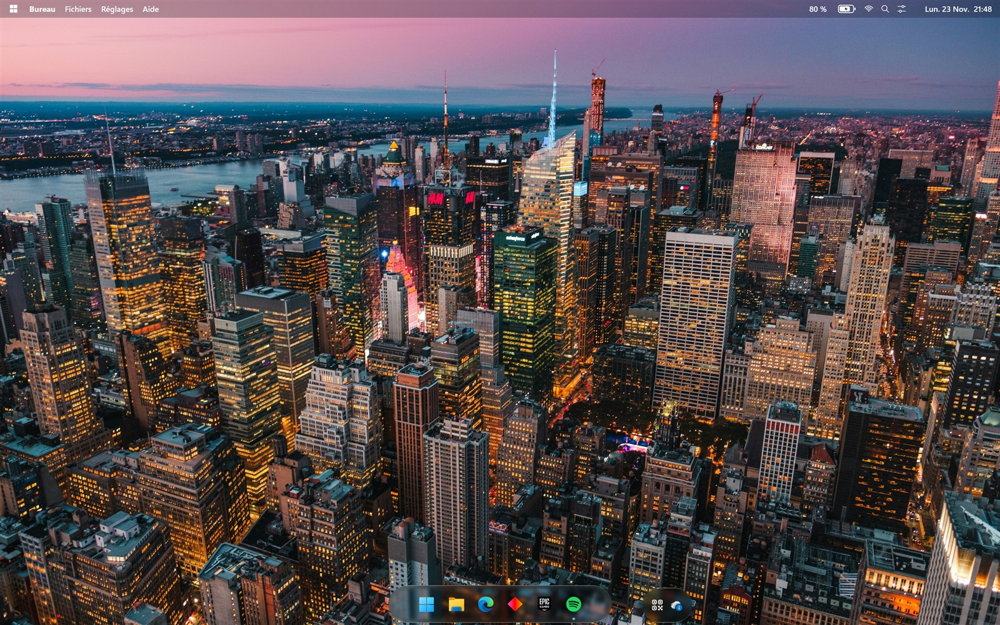
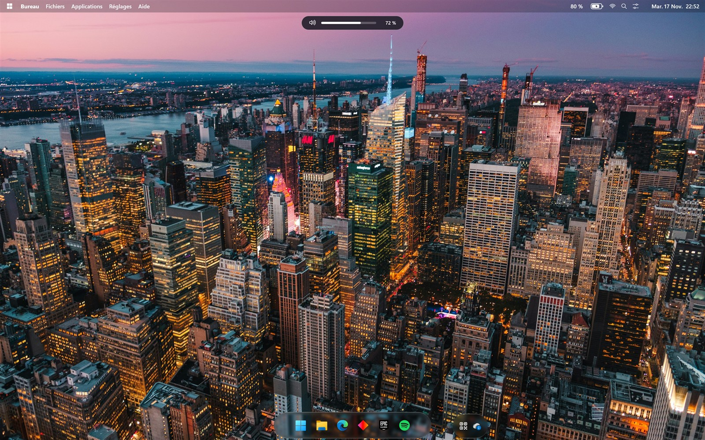
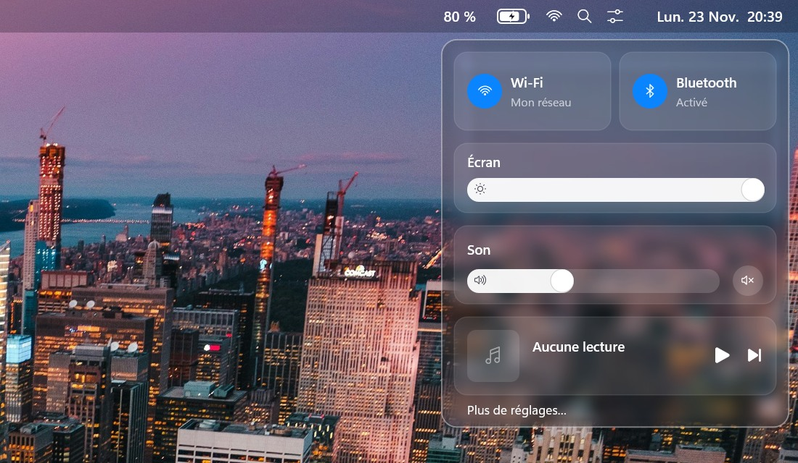
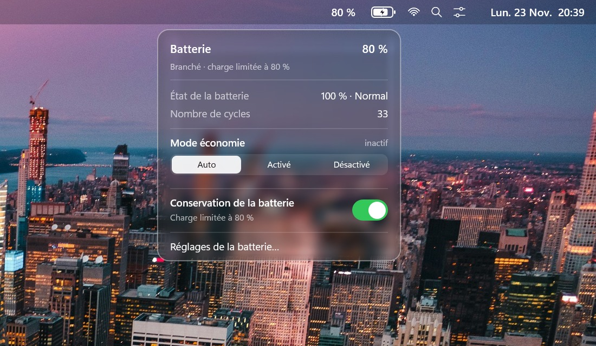

# 🍏 Interface « style Mac » pour Windows 11

[](LICENSE)
[](https://www.microsoft.com/windows/windows-11)
[](https://learn.microsoft.com/powershell/)
[](https://www.rainmeter.net/)
[](https://windhawk.net/)

Transforme Windows 11 pour qu'il ressemble à macOS, **en un double-clic** :

- **Barre des menus en haut** : logo, menus, batterie, Wi-Fi, recherche, centre de contrôle, date et heure. Les fenêtres agrandies s'arrêtent dessous, comme sur Mac.
- **Dock en verre en bas** : icônes centrées, **effet loupe** au survol, petits points sous les applications ouvertes.
- 🎛️ **Centre de contrôle façon Mac** (icône ⚙) : tuiles Wi-Fi et Bluetooth (on/off), curseurs Écran et Son qu'on peut faire glisser, musique en cours avec pochette (lecture/pause, suivant), en verre comme le dock.
- 🔋 **Panneau batterie en verre** (clic sur la batterie) : santé de la batterie en %, nombre de cycles, temps restant ; mode économie **Auto / Activé / Désactivé** ; **conservation de la batterie** (charge limitée à 80 %, PC HP) avec la fenêtre d'autorisation de Windows à chaque changement.
- **Wi-Fi dynamique** : comme sur Mac, les arcs s'allument selon la force du signal, et l'icône est barrée sans connexion ou sans accès à Internet.
- **Pastilles de volume et de luminosité** façon Apple : barre blanche et pourcentage, sous la barre des menus.
- **Batterie intelligente** : blanche sur batterie, verte avec éclair en charge, **jaune en mode économie**, rouge sous 20 %.
- 🔋 **Mode économie automatique sur batterie** (PC portables) : dès que vous débranchez, l'écran passe à 60 Hz, la luminosité est plafonnée et les programmes inutiles en arrière-plan sont fermés. **Plus d'autonomie, sans rien faire.** Tout revient au rebranchement. [Détails ↓](#-mode-économie-sur-batterie)
- **Fond d'écran** Manhattan de nuit, en 4K.
- Démarrage **invisible et rapide**, avec relance automatique si quelque chose plante.

> Tout s'adapte à l'écran de chaque PC (échelle d'affichage 100 %, 125 %, 150 %…, toutes résolutions, avec ou sans batterie).

---

## 📸 Aperçu



| Pastille de volume | Pastille de luminosité |
|---|---|
|  |  |

| Centre de contrôle (icône ⚙) | Panneau batterie (clic sur la batterie) |
|---|---|
|  |  |

## 🔋 Mode économie sur batterie

> **Le point fort pour les PC portables : gagnez de l'autonomie automatiquement, sans y penser.**

Débranchez le chargeur (ou activez l'économiseur de batterie de Windows) : après **15 secondes**, l'interface passe d'elle-même en mode économie.

| | Branché | Sur batterie |
|---|---|---|
| Fréquence de l'écran | maximale (ex. 240 Hz) | **60 Hz** |
| Luminosité | libre | **plafonnée à 60 %** |
| Programmes en arrière-plan | ouverts | **fermés** : NVIDIA Overlay, Steam, Widgets, Spotify, WhatsApp, Discord, OMEN Light Studio… |
| Icône de batterie | blanche avec éclair, ou verte en charge | **jaune** (mode économie actif), rouge sous 20 % |

- **Au rebranchement**, tout revient : fréquence maximale, luminosité libre, et les programmes fermés sont relancés, fenêtres réduites (sauf ceux marqués `"relancer": false`, comme NVIDIA Overlay et Widgets).
- Le délai de 15 secondes évite de tout basculer si le câble se débranche une seconde.
- Les programmes absents du PC sont simplement ignorés.
- Tout se règle dans `config.json` (voir [Personnalisation](#️-personnalisation)) : fréquence, luminosité, liste des programmes, ou `"actif": false` pour couper le mode.

---

## ✅ Prérequis

| | |
|---|---|
| Système | **Windows 11** (22H2 ou plus récent) |
| Compte | Un compte **administrateur** (pour installer les logiciels et le dock) |
| Internet | Oui, pendant l'installation |
| `winget` | Déjà présent sur Windows 11 (sinon : « App Installer » sur le Microsoft Store) |

## 🚀 Installation

1. Téléchargez le dépôt : bouton **Code → Download ZIP**, puis décompressez-le. Ou bien :
   ```bash
   git clone https://github.com/medMansouri25/windows-mac-style.git
   ```
2. Double-cliquez sur **`INSTALLER.bat`**.
3. Cliquez sur **Oui** quand Windows demande l'autorisation.
4. Attendez 2 à 3 minutes. L'écran clignote une fois, c'est normal.
5. Conseil : fermez puis rouvrez votre session une fois.

C'est tout. L'interface se relance seule à chaque démarrage.

## ↩️ Désinstallation

Double-cliquez sur **`DESINSTALLER.bat`**. Tout est remis comme avant : barre des tâches, fond d'écran, réglages. Il vous demande si vous voulez aussi supprimer Rainmeter et Windhawk.

## ⚙️ Personnalisation

Modifiez **`app/config.json`** avant l'installation, ou `%LOCALAPPDATA%\InterfaceMac\config.json` après :

| Réglage | Rôle |
|---|---|
| `barre.hauteur` | hauteur de la barre des menus (30 par défaut) |
| `barre.nomMenuPrincipal` | texte en gras après le logo (« Bureau ») |
| `fondEcran.url` | image du fond d'écran |
| `dock.hauteur`, `dock.tailleIcones`, `dock.grossissementLoupe` | taille du dock et de l'effet loupe |
| `economie.actif` | activer ou désactiver le mode économie |
| `economie.frequenceBatterie` | fréquence de l'écran sur batterie (60 Hz) |
| `economie.luminositeMaxBatterie` | luminosité maximale sur batterie (60 %) |
| `economie.programmes` | programmes à fermer sur batterie (et à relancer ou non) |

Après une modification, relancez `INSTALLER.bat` (vos sauvegardes d'origine sont conservées).

## 🧱 Ce qui est installé

| Composant | Rôle | Source |
|---|---|---|
| [Rainmeter](https://www.rainmeter.net/) | barre des menus et pastilles | `winget` (officiel) |
| [Windhawk](https://windhawk.net/) | transforme la barre des tâches en dock | `winget` (officiel) |
| Modules Windhawk : *Windows 11 Taskbar Styler*, *Taskbar Dock Animation*, *Taskbar height and icon size*, *On-Screen Indicator Position* | thème verre, effet loupe, taille, masquage des indicateurs Windows | [mods.windhawk.net](https://windhawk.net/mods) (versions testées et figées) |
| Scripts PowerShell de ce dépôt | démarrage, réservation de la barre, mode économie | ce dépôt |

Aucun réglage de sécurité de Windows n'est modifié (antivirus, pare-feu, contrôle de compte…).

## 📚 Documentation

- [docs/GUIDE.txt](docs/GUIDE.txt) : guide d'utilisation, aussi ouvert par le menu « Aide » de la barre.
- [docs/FONCTIONNEMENT.md](docs/FONCTIONNEMENT.md) : comment tout fonctionne techniquement.
- [docs/DEPANNAGE.md](docs/DEPANNAGE.md) : problèmes connus et solutions.

## 📁 Structure du dépôt

```
INSTALLER.bat            → double-clic pour installer
DESINSTALLER.bat         → double-clic pour tout retirer
app/                     → l'interface (copiée dans %LOCALAPPDATA%\InterfaceMac)
  config.json            → vos réglages
  barre_reservee.ps1     → « moteur » : réserve la barre, surveille Rainmeter, batterie, luminosité
  demarrer_interface.ps1 → lancé à l'ouverture de session (tâche planifiée invisible)
  generer_skins.ps1      → crée la barre et les pastilles adaptées à l'écran
  economie.ps1           → mode économie sur batterie
  frequence_ecran.ps1    → change la fréquence de l'écran (60/240 Hz…)
  fond_ecran.ps1         → applique le fond d'écran
  batterie.lua           → logique de l'icône de batterie
  infos_batterie.ps1     → remplit le panneau batterie (santé, cycles, temps restant)
  conservation.ps1       → mode conservation HP (demande l'autorisation à chaque fois)
  raccourci.ps1, *.vbs   → lanceurs invisibles et raccourcis clavier
install/
  installer.ps1          → installation complète
  desinstaller.ps1       → désinstallation complète
docs/                    → documentation
```

## ⚠️ Avertissement

Windhawk modifie l'Explorateur Windows pendant qu'il tourne. Les versions des modules sont figées sur celles testées, et l'installateur vérifie l'absence de plantage, puis se corrige seul si besoin. Testé sur Windows 11 26H2. À utiliser à vos risques : la désinstallation remet tout comme avant.

## 🙏 Crédits

- [Rainmeter](https://github.com/rainmeter/rainmeter) (GPL-2.0), [Windhawk](https://github.com/ramensoftware/windhawk) et ses modules (m417z, Ph0en1x-dev, mario0318…).
- Fond d'écran : photo [Unsplash](https://unsplash.com) (licence Unsplash), téléchargée pendant l'installation.
- Interface inspirée de macOS. Ce projet n'est pas affilié à Apple.

## 📄 Licence

Ce projet est sous licence **MIT** : voir le fichier [LICENSE](LICENSE). Rainmeter, Windhawk et ses modules gardent leurs propres licences.
